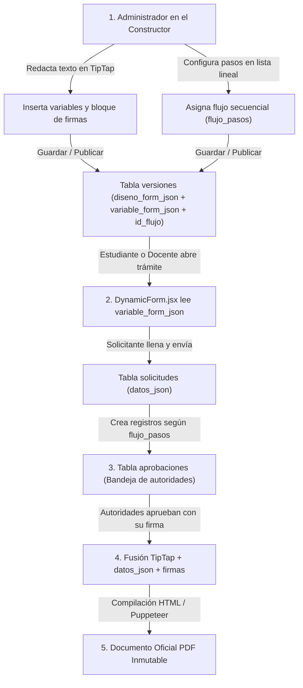

# Constructor de Documentos — SIADU

## 1. Visión General y Principio Rector

El **Constructor de Documentos** permite a los administradores institucionales diseñar y gestionar plantillas de documentos oficiales para la Facultad de Informática, Electrónica y Comunicación (FIEC) y dependencias de la Universidad de Panamá.

### Principio Fundamental del Constructor
> **El formulario web no se diseña en una pantalla aislada; el formulario se genera automáticamente a partir de las variables que el Administrador inserta en el texto de la plantilla.**

1. El Administrador redacta el documento oficial en el editor enriquecido (TipTap).
2. En los puntos donde el texto requiere información variable, incrusta una **cápsula de variable** (ej. `[Motivo_Retiro]`, `[Codigo_Asignatura]`).
3. El motor del frontend lee esa lista de variables y **construye automáticamente el formulario web dinámico** para el solicitante con los controles y restricciones configurados.

---

## 2. Datos Automáticos (Variables de Sistema y Sesión)

Estos datos **nunca se le solicitan al usuario en el formulario**. El sistema los extrae de forma inmutable a partir de la sesión autenticada y los registros de la base de datos (`usuarios`, `personal`, `estudiantes`, `unidades`, `carreras`), inyectándolos directamente en la hoja oficial.

Los valores se **congelan al radicar** la solicitud: el backend los guarda en `solicitudes.datos_json` bajo la clave reservada `_sistema` y los entrega en `variablesSistema` (`GET /api/requests/{id}`). Así el documento no cambia si después cambian los datos del solicitante. Cuando una variable no aplica al solicitante (por ejemplo, `estudiante.carrera` para un profesor) vale `null` y no se imprime nada.

| Variable | Origen en BD / Sesión | Ejemplo de Valor Generado | Comportamiento |
| :--- | :--- | :--- | :--- |
| **`auth.nombre_completo`** | `personal` / `estudiantes` | `"Alex Demo"` | Inmutable. Se estampa en el documento. |
| **`auth.cedula`** | `usuarios.cedula` | `"9-000-0001"` | Inmutable. Identificación oficial. |
| **`auth.correo`** | `usuarios.correo` | `"alex.demo@up.ac.pa"` | Inmutable. Correo institucional UP. |
| **`estudiante.carrera`** | `carreras.descripcion` | `"Licenciatura en Ingeniería en Informática"` | Solo aplica si el rol es Estudiante. |
| **`estudiante.escuela`** | `carreras` → escuela | `"Escuela de Ingeniería Informática"` | Escuela de la carrera del estudiante. Sirve para el membrete (`{{estudiante.escuela}}`) y para elegir al director que aprueba. |
| **`estudiante.facultad`** | `unidades.nombre` | `"Facultad de Informática, Electrónica y Comunicación"` | Unidad académica a la que pertenece. |
| **`personal.cargo`** | `cargos.nombre` | `"Director/a de Escuela"` | Solo aplica si el solicitante es Docente/Admin. |
| **`personal.departamento`**| `departamentos.nombre`| `"Informática"` | Departamento de adscripción. |
| **`sistema.fecha_formal`** | `solicitudes.fecha_creacion` formateada | `"Panamá, 5 de octubre de 2026"` | Fecha de radicación de la solicitud. |
| **`solicitud.codigo`** | `solicitudes.codigo_documento` | `"UP24-2026-0001"` | Código correlativo único institucional. |

---

## 3. Recolección de Datos: Elementos del Formulario y Restricciones Técnicas

Cada variable que el Administrador inserta en el documento para que la complete el solicitante usa uno de los **5 elementos de recolección estándar**.

> **Archivos adjuntos:** el formulario no recibe archivos. Todas las respuestas se guardan como campos estructurados en `JSONB`.

### Catálogo de Elementos y sus Restricciones Configurables:

| Elemento | Tipo Técnico | Propósito en el Documento | Restricciones Configurables por el Administrador |
| :--- | :---: | :--- | :--- |
| **1. Texto Corto** | `text` | Códigos de curso (`INF-101`), nombres de asignaturas, instituciones o temas de tesis. | • **Requerido:** `true` / `false`<br>• **Longitud mínima y máxima:** (ej. min 3, max 60 caracteres)<br>• **Formato:** Libre, Solo letras, Alfanumérico o Mayúsculas obligatorias. |
| **2. Texto Largo** | `textarea` | Justificaciones, cartas de motivos, exposición de hechos o explicaciones detalladas. | • **Requerido:** `true` / `false`<br>• **Mínimo de caracteres:** (ej. min 30 para evitar justificaciones vacías)<br>• **Máximo de caracteres:** (ej. max 600 para evitar desborde de la hoja de papel). |
| **3. Número** | `number` | Calificaciones reclamadas, créditos, semestres o cantidades. | • **Requerido:** `true` / `false`<br>• **Valor mínimo y máximo:** (ej. de 0 a 100 en notas)<br>• **Decimales:** Permitidos (`true`) o Solo enteros (`false`). |
| **4. Fecha** | `date` | Fechas puntuales de inasistencias, citas médicas o exámenes. | • **Requerido:** `true` / `false`<br>• **Regla temporal:** Libre, Solo fechas pasadas o Solo fechas futuras<br>• **Días hábiles:** Opción de deshabilitar fines de semana. |
| **5. Selector de Opciones** | `select` o `radio` | Motivos de retiro, turnos, semestres, modalidades académicas. | • **Requerido:** `true` / `false`<br>• **Lista de Opciones del Admin:** El Administrador escribe libremente las opciones para esa plantilla (`[{ valor, etiqueta }]`)<br>• **Opción "Otro":** Habilita automáticamente un campo de texto adicional si el usuario marca "Otro". |
| **Confirmación Legal** | `checkbox` | Declaración jurada de veracidad de la información. | • **Requerido:** Siempre `true` (bloquea el botón de envío si no se marca)<br>• **Texto legal:** Redacción del compromiso institucional. |

---

## 4. Funciones de Edición en el Lienzo del Documento (TipTap)

El lienzo central simula una **hoja física tamaño Carta (Letter)** con márgenes institucionales estándar. El Administrador cuenta con las siguientes herramientas de edición:

### A. Tipografía y Estilos Institucionales
- **Fuentes Permitidas:** Exclusivamente tipografías formales aprobadas por la Universidad de Panamá: **Arial** o **Times New Roman**.
- **Tamaños Jerárquicos:**
  - *Título Principal (`H1`):* 16pt / Negrita (para encabezados de resoluciones y oficios).
  - *Subtítulo (`H2`):* 14pt / Negrita (para secciones: "CONSIDERANDO", "RESUELVE").
  - *Texto Normal (`P`):* 11pt o 12pt (cuerpo de la carta).
- **Formato de Carácter:** **Negrita** (`Ctrl+B`), *Cursiva* (`Ctrl+I`) y Subrayado (`Ctrl+U`).

### B. Alineación y Espaciados (Interlineado y Sangría)
- **Alineación Justificada (Obligatoria):** Botón de justificación de texto completa, estándar obligatorio en correspondencia académica oficial.
- **Alineaciones Adicionales:** Izquierda, Centrado y Derecha.
- **Interlineado (Line Spacing):** Selector rápido en la barra de herramientas:
  - **`1.0` (Sencillo):** Para párrafos compactos, tablas y listas.
  - **`1.15` (Estándar UP):** Espaciado institucional por defecto para oficios y cartas.
  - **`1.5` (Amplio):** Para resoluciones formales y decretos.
- **Sangría (Tabulación):** Botones de *Aumentar Sangría* y *Disminuir Sangría* (`Tab` / `Shift+Tab`) para la primera línea de párrafos o citas formales.
- **Espaciado entre Párrafos:** Margen inferior uniforme de 8px a 12px entre párrafos para evitar dobles saltos de línea manuales.

### C. Tablas y Listas
- **Listas:** Con viñetas circulares (`•`) o numeradas (`1, 2, 3...`).
- **Tablas Estructuradas:** Inserción de tablas con cuadrícula formal para materias o equivalencias (opciones de agregar/eliminar filas y columnas).

### D. Control de Páginas e Historial
- **Salto de Página Manual (`PageBreak`):** Inserta un corte de hoja explícito para obligar a que un anexo o sección comience en una nueva página.
- **Deshacer y Rehacer:** `Ctrl+Z` y `Ctrl+Y`.

---

## 5. Encabezado y Pie de Página Institucional (Personalizable por Plantilla)

El documento formal cuenta con dos zonas institucionales que vienen **precargadas automáticamente con la identidad gráfica oficial de la Universidad de Panamá**, pero con **total libertad de edición para el Administrador** en cada plantilla:

```
┌────────────────────────────────────────────────────────────────────────┐
│  [Escudo UP]          UNIVERSIDAD DE PANAMÁ             [Logo FIEC]    │
│            FACULTAD DE INFORMÁTICA, ELECTRÓNICA Y COMUNICACIÓN         │
│                 ESCUELA DE INGENIERÍA EN INFORMÁTICA                   │
├────────────────────────────────────────────────────────────────────────┤
│                                                                        │
│  CUERPO DEL DOCUMENTO (Lienzo TipTap con variables y firmas)           │
│                                                                        │
├────────────────────────────────────────────────────────────────────────┤
│ 2026: "Año del Fortalecimiento de la Autonomía Universitaria..."       │
│        Estafeta Universitario, Panamá, República de Panamá             │
│                     Teléfono 523-6008-6001                             │
└────────────────────────────────────────────────────────────────────────┘
```

### A. Encabezado Institucional (Header)
- **Logos Oficiales:**
  - *Izquierda:* Escudo oficial de la Universidad de Panamá (`/logos/escudo_up.png`).
  - *Derecha:* Logo de la FIEC (`/logos/logo_fiec.png`).
  - *Libertad:* El Administrador puede reemplazar logos o desactivar uno de ellos si el trámite es de otra unidad.
- **Membrete Jerárquico Editable (3 o 4 líneas):**
  - **Línea 1:** Institución (por defecto: `UNIVERSIDAD DE PANAMÁ`).
  - **Línea 2:** Facultad (por defecto: `FACULTAD DE INFORMÁTICA, ELECTRÓNICA Y COMUNICACIÓN`).
  - **Línea 3:** Dependencia emisora libremente editable por el Admin:
    - *Ejemplos:* `ESCUELA DE INGENIERÍA EN INFORMÁTICA`, `DESPACHO DEL DECANO`, `DEPARTAMENTO DE INFORMÁTICA`, `DIRECCIÓN DE INVESTIGACIÓN Y POSTGRADO`.
  - **Línea 4 (Opcional):** Sección, coordinación o despacho específico.

### B. Pie de Página Institucional (Footer)
Va al fondo de **cada** hoja. Es **texto libre con formato**: el Administrador hace clic en el pie de la hoja y escribe directamente, igual que en el cuerpo. Mientras edita el pie, la barra de herramientas cambia a sus opciones: **negrita**, *cursiva*, subrayado, alineación (izquierda, centro, derecha) y tamaño de letra (7, 8, 9 o 10 pt; por defecto 8 pt). Puede agregar o quitar líneas libremente.

El pie institucional que trae cada plantilla nueva:
- **Lema Oficial del Año** (en cursiva): `2026: “Año del Fortalecimiento de la Autonomía Universitaria, mediante la Elección Democrática de sus Autoridades”`. Se cambia en la plantilla, sin tocar código, al cambiar de año.
- **Ubicación Física:** `Estafeta Universitario, Panamá, República de Panamá`.
- **Teléfonos y Contacto:** `Teléfono 523-6008-6001`.
- **Paginación Dinámica:** opción del panel «Membrete y pie» para imprimir *«Página X de Y»* (alineada a la derecha) en cada hoja.

El pie se puede ocultar por completo desde el mismo panel.

---

## 6. Componente de Bloque de Firmas

El **Bloque de Firmas** es un componente estructurado que el Administrador arrastra al final del documento. Se conecta automáticamente con el **Flujo de Aprobación** asignado a la plantilla.

### A. Distribución Automática (Layout)
El bloque tiene una casilla por cada paso del flujo con **requiere firma** (`reqFirma`), en orden de secuencia, distribuidas en filas de 2:
- **1 Firma:** Centrada en la parte inferior de la hoja.
- **2 Firmas:** Distribuidas en 2 columnas paralelas (izquierda y derecha).
- **3 Firmas:** 2 firmas en la fila superior y 1 firma centrada en la fila inferior.
- **4 o más:** Se siguen agregando filas de 2; si la última queda con una sola firma, va centrada.

Solo puede haber un bloque de firmas por documento, y es obligatorio si algún paso del flujo requiere firma (se valida al publicar).

### B. Contenido de Cada Casilla de Firma
Al momento de la aprobación por la autoridad correspondiente:
1. **Imagen de Firma:** Se inyecta la firma digitalizada autorizada desde la tabla `firmas`.
2. **Línea de Firma Horizontal.**
3. **Nombre y Título Oficial:** (ej. *"Dr. Julio Demo"*).
4. **Cargo Institucional:** (ej. *"Decano de la Facultad de Informática, Electrónica y Comunicación"*).
5. **Estampa de Aprobación:** Fecha y hora exacta de la aprobación.

### C. Regla de Protección Anti-Ruptura (`break-inside: avoid`)
El bloque de firmas se compone de filas de hasta 2 casillas, y cada fila tiene la regla de impresión estricta `break-inside: avoid;`. Si el cuerpo del texto deja poco espacio al final de la página, **ninguna casilla se divide por la mitad**: las filas que caben quedan en la página y las demás pasan completas a la siguiente (con 4 firmas, por ejemplo, 2 en una página y 2 en la otra). Si no cabe ninguna fila, el bloque entero pasa a la página siguiente.

---

## 7. Estructuras de Datos JSON

Toda la lógica anterior se materializa en los dos campos `JSONB` de la tabla `versiones` y el campo `datos_json` de la tabla `solicitudes` (estrictamente en convención **`camelCase`**):

### A. `variableFormJson` (Definición del Formulario en `versiones`)
```json
{
  "variables": [
    {
      "id": "codigoAsignatura",
      "etiqueta": "Código y Nombre de Asignatura",
      "tipo": "text",
      "requerido": true,
      "placeholder": "Ej: INF-101 Programación I",
      "validaciones": { "min": 5, "max": 80 }
    },
    {
      "id": "motivoRetiro",
      "etiqueta": "Motivo del Retiro",
      "tipo": "select",
      "requerido": true,
      "placeholder": "-- Seleccione un motivo --",
      "opciones": [
        { "valor": "LABORAL", "etiqueta": "Cruce de horario laboral" },
        { "valor": "SALUD", "etiqueta": "Problemas de salud certificados" },
        { "valor": "PERSONAL", "etiqueta": "Motivo personal o familiar" }
      ]
    },
    {
      "id": "justificacion",
      "etiqueta": "Explicación Detallada",
      "tipo": "textarea",
      "requerido": true,
      "placeholder": "Describa brevemente la justificación...",
      "validaciones": { "min": 25, "max": 500 }
    }
  ]
}
```

### B. `datosJson` (Respuestas Enviadas por el Solicitante en `solicitudes`)
```json
{
  "codigoAsignatura": "INF-204 Base de Datos I",
  "motivoRetiro": "LABORAL",
  "justificacion": "Cambio de turno en la empresa que coincide con las horas de laboratorio."
}
```

### C. `disenoFormJson` (Diseño Visual Completo en `versiones`)
Contiene la personalización del membrete, el árbol AST de TipTap y la configuración del pie de página:
```json
{
  "formato": { "fuente": "Arial", "tamano": "11pt", "interlineado": "1.15" },
  "encabezado": {
    "activo": true,
    "logoIzqUrl": "/logos/escudo_up.png",
    "logoDerUrl": "/logos/logo_fiec.png",
    "linea1": "UNIVERSIDAD DE PANAMÁ",
    "linea2": "FACULTAD DE INFORMÁTICA, ELECTRÓNICA Y COMUNICACIÓN",
    "linea3": "{{estudiante.escuela}}"
  },
  "cuerpoDocumento": {
    "type": "doc",
    "content": [
      {
        "type": "paragraph",
        "attrs": { "textAlign": "justify", "lineHeight": "1.15" },
        "content": [
          { "type": "text", "text": "Por este medio solicito formalmente el retiro de la asignatura " },
          { "type": "variable", "attrs": { "id": "codigoAsignatura" } },
          { "type": "text", "text": " debido a " },
          { "type": "variable", "attrs": { "id": "motivoRetiro" } },
          { "type": "text", "text": "." }
        ]
      },
      {
        "type": "signatureBlock"
      }
    ]
  },
  "piePagina": {
    "activo": true,
    "contenido": {
      "type": "doc",
      "content": [
        {
          "type": "paragraph",
          "attrs": { "textAlign": "center" },
          "content": [
            {
              "type": "text",
              "text": "2026: “Año del Fortalecimiento de la Autonomía Universitaria, mediante la Elección Democrática de sus Autoridades”",
              "marks": [{ "type": "italic" }]
            }
          ]
        },
        { "type": "paragraph", "attrs": { "textAlign": "center" }, "content": [{ "type": "text", "text": "Estafeta Universitario, Panamá, República de Panamá" }] },
        { "type": "paragraph", "attrs": { "textAlign": "center" }, "content": [{ "type": "text", "text": "Teléfono 523-6008-6001" }] }
      ]
    },
    "mostrarPaginacion": true
  }
}
```

---

## 8. Configuración del Flujo de Aprobación en el Constructor (Asignación de Pasos)

A nivel de arquitectura de base de datos, el flujo **no utiliza estructuras JSON dinámicas**, sino que aprovecha la integridad de las tablas relacionales `flujos` y `flujo_pasos`, vinculadas a las autoridades en `asignaciones_administrativos`.

### A. Interfaz del Administrador (Lista Secuencial Lineal)
En lugar de un diagramador BPMN complejo, el constructor proporciona una interfaz secuencial limpia. Vive en la pestaña **«Aprobación»** del panel del editor, junto al documento: cada cambio se refleja al momento en el bloque de firmas de la hoja, y hacer clic en ese bloque abre la pestaña. El asistente queda en tres pasos: datos básicos, documento y aprobación, y resumen.

```
┌────────────────────────────────────────────────────────────────────────┐
│ CONFIGURACIÓN DEL FLUJO DE APROBACIÓN                                  │
│                                                                        │
│ Paso 1:                                                                │
│ [ Seleccionar Autoridad / Asignación: Dra. Lia Muestra ▼ ]         │
│ ↳ Cargo detectado: Directora de Escuela de Ingeniería Informática      │
│ [x] Requiere firma en el documento             [ ↑ ] [ ↓ ] [Eliminar]│
│                                                                        │
│ Paso 2:                                                                │
│ [ Seleccionar Autoridad / Asignación: Dr. Julio Demo ▼ ]         │
│ ↳ Cargo detectado: Decano de la FIEC                                   │
│ [x] Requiere firma en el documento             [ ↑ ] [ ↓ ] [Eliminar]│
│                                                                        │
│ [+ Agregar Paso al Flujo]                                              │
└────────────────────────────────────────────────────────────────────────┘
```

**Pasos por escuela.** Un estudiante no habla con un único director: le corresponde el de la escuela de su carrera. Por eso un paso puede ser «Director/a de Escuela del solicitante» (`alcance: ESCUELA_SOLICITANTE`, con `idCargo` en vez de `idAsignacion`): al radicar, el sistema toma al titular de ese cargo en la escuela del estudiante, y el mismo flujo sirve a todas las escuelas. Los cargos de toda la facultad (Decano/a, Vicedecano/a, Secretaría Administrativa) y los de departamento se eligen como siempre, por persona (`FIJO`). Las líneas del membrete admiten marcadores como `{{estudiante.escuela}}`; el valor se imprime en mayúsculas y la línea se omite si no aplica al solicitante. Solo se incluyen cargos de autoridad: directores, decano, vicedecanos, secretarias de cada director y Secretaría Administrativa.

### B. Comportamiento y Controles en la Interfaz
1. **Selección por Autoridad Asignada:** Al seleccionar una autoridad en el desplegable, el sistema utiliza su `idAsignacion` único de `asignaciones_administrativos`.
2. **Requerimiento de Firma (`reqFirma`):** Casilla que define si esa autoridad estampará su firma gráfica en el bloque de firmas (`true`, por defecto) o si solo emite un visto bueno administrativo sin firma gráfica (`false`).
3. **Reordenamiento Intuitivo:** Botones `[ ↑ ]` y `[ ↓ ]` que ajustan automáticamente el valor numérico del campo `secuencia` (1, 2, 3...).
4. **Persistencia:** Los flujos se crean en el módulo de flujos (`POST /api/flows`) y la plantilla se vincula mediante `idFlujo` (`versiones.id_flujo`).

### C. Payload Oficial para Crear/Actualizar Flujo (`POST /api/flows`)
```json
{
  "nombre": "Aprobación Estándar FIEC (Escuela + Decanato)",
  "codigo": "FLUJO-FIEC-ESC-DEC",
  "codUnidad": 24,
  "pasos": [
    {
      "secuencia": 1,
      "idAsignacion": 12,
      "reqFirma": true
    },
    {
      "secuencia": 2,
      "idAsignacion": 1,
      "reqFirma": true
    }
  ]
}
```

---

## 9. Resumen del Flujo de Integración de Extremo a Extremo


